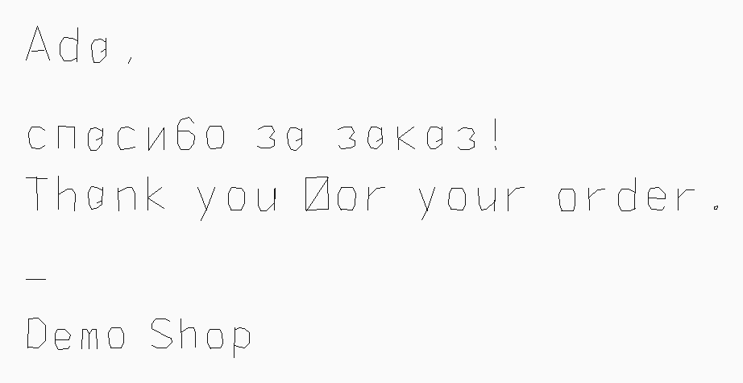
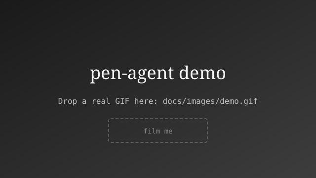
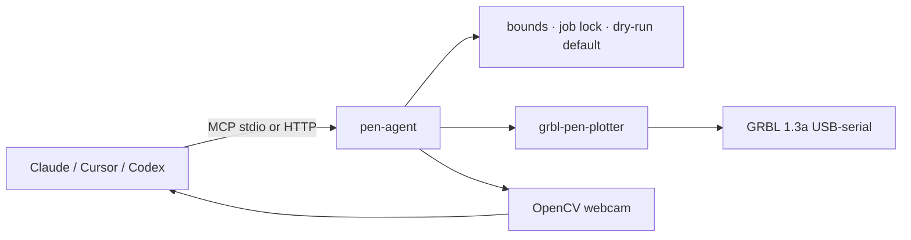

# pen-agent

**Give your agent a pen.**

An MCP server that lets Claude, Cursor, Codex, or any agent write real handwriting and draw SVG on a GRBL pen plotter — with dry-run previews, webcam eyes, and a big red abort.

Built on [`grbl-pen-plotter`](https://github.com/NikEdtech/grbl-pen-plotter). Calibrated for JinGan / BtWriter-class machines. Works on **macOS, Windows, and Linux**.

> **Why a separate repo?** The sender library stays small and boring; pen-agent is the viral product layer (MCP, skills, remote HTTP, camera, handwriting templates).

## Demo




<!-- Drop a real GIF at docs/images/demo.gif when you film the plotter -->


## 60-second quickstart

```bash
# Python 3.10+
pip install "git+https://github.com/NikEdtech/pen-agent"
# or: uvx --from git+https://github.com/NikEdtech/pen-agent pen-agent thankyou Ada

pen-agent thankyou "Ada" --message "thanks for the order!" --brand "Demo Shop"
# → writes artifacts/*.png preview (dry-run, no hardware)

pen-agent-mcp   # stdio MCP for Claude Desktop / Cursor
```

One-liner with uv:

```bash
uvx --from git+https://github.com/NikEdtech/pen-agent pen-agent thankyou "Ada"
```

## Architecture



Remote agents (Mac → always-on Windows host over Tailscale):

```text
Agent  --Bearer token-->  http://win-pc:8765/mcp  -->  pen-agent  -->  COM3 plotter
                                                     \->  HD Webcam
```

## MCP tools

| Tool | Purpose |
|------|---------|
| `list_ports` / `status` | Find the plotter, read Idle/MPos |
| `write_text` | Handwriting (Latin+Cyrillic), jitter, postcard/`thankyou` template |
| `draw_svg` | SVG paths → toolpath |
| `preview` | Toolpath → PNG |
| `plot` | Stream G-code (**dry-run default**; live needs `confirm=true`) |
| `pen_up` / `pen_down` / `home` | Pen + work zero (`G92`) |
| `abort` | Soft-reset + pen up |
| `capture_photo` | Webcam frame so the agent can see the page |

## Agent configs

- Claude Desktop: [`examples/claude_desktop.json`](examples/claude_desktop.json)
- Cursor: [`examples/cursor_mcp.json`](examples/cursor_mcp.json)
- Codex: [`examples/codex_config.toml`](examples/codex_config.toml)
- OpenClaw-style: [`examples/openclaw.json`](examples/openclaw.json)
- Skill: [`skills/pen-agent/SKILL.md`](skills/pen-agent/SKILL.md)

## Safety

- Dry-run by default (`PEN_AGENT_DRY_RUN_DEFAULT=1`)
- Live plot requires `dry_run=false` **and** `confirm=true`
- Bounds check + max path / line limits
- Single-flight job lock
- Abort on GRBL alarm
- HTTP Bearer token (`PEN_AGENT_TOKEN`) for remote MCP

## Windows always-on host

```powershell
# On DESKTOP-… (plotter + webcam permanently plugged in)
git clone https://github.com/NikEdtech/pen-agent C:\Users\admin\Code\pen-agent
cd C:\Users\admin\Code\pen-agent
powershell -ExecutionPolicy Bypass -File deploy\windows\install.ps1
powershell -ExecutionPolicy Bypass -File deploy\windows\register-task.ps1
Start-ScheduledTask -TaskName pen-agent-mcp-http
```

Point Cursor/Claude at `http://<tailscale-host>:8765/mcp` with `Authorization: Bearer <token>` from `deploy/windows/.token`.

## First real hardware test (only when paper is loaded)

```powershell
# On the Windows host, after parking at sheet corner with pen RAISED:
$env:PEN_AGENT_PORT = "COM3"   # from pen-agent ports
pen-agent-mcp   # or use MCP write_text / plot from your agent
# Agent flow: home → write_text(dry_run=true) → human OK → write_text(dry_run=false, confirm=true) → capture_photo
```

**Do not plot until the human confirms the plotter is connected and paper is loaded.**

## Develop

```bash
git clone https://github.com/NikEdtech/pen-agent
cd pen-agent
python -m venv .venv && source .venv/bin/activate  # or .venv\Scripts\activate
pip install -e ".[dev]"
pytest -q
```

## License

MIT. Depends on MIT [`grbl-pen-plotter`](https://github.com/NikEdtech/grbl-pen-plotter). No vendor binaries or proprietary fonts.
